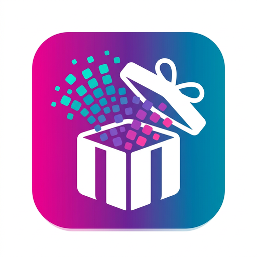
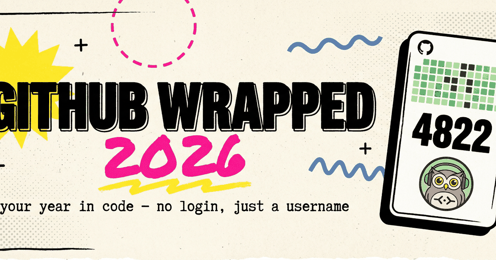

[English](README.md) | [Русский](README.ru.md) | [Español](README.es.md) | **Português**

<div align="center">



# GitHub Wrapped 2026

**Seu ano em codigo como uma historia bonita para compartilhar. Sem login: so o usuario.**

[](https://hilsetapp.github.io/Wrapped-2026/)
[](LICENSE)



</div>

---

## ✨ O que e isso?

O Spotify Wrapped do GitHub. Voce digita qualquer usuario e recebe uma **historia animada**
(slides que passam com um toque, como no Instagram) sobre o ano de 2026 dessa pessoa:

- 📊 **os numeros principais**: contribuicoes, pull requests, repos novos, estrelas ganhas
- 🎨 **seus principais linguagens** com barras animadas
- 🟩 **sua grade de contribuicoes**, pintada: maior sequencia, dia mais intenso
- 🦉 **seu ritmo de codigo**: coruja da noite ou programador diurno?
- 🃏 **seu arquetipo**: *Coruja da Noite, AI Native, Guerreiro de Fim de Semana, Polyglot…*
- 📦 **os repos que marcaram seu ano** e sua pegada na era da IA
- 🌍 **interface em ingles, russo, espanhol e portugues**: troca com um toque, funciona ate no meio da historia

No final, um **poster PNG 1080×1350 para compartilhar** (o ano, sua grade, linguagens,
ritmo, arquetipo e um QR que volta para o site) para baixar e postar em qualquer lugar.

## 🚀 Testar em 10 segundos

> **https://hilsetapp.github.io/Wrapped-2026/**

1. Abra o link.
2. Digite qualquer usuario do GitHub: o seu, o de um amigo, `torvalds`…
3. Passe os slides, baixe o poster e compartilhe.

Sem conta, sem OAuth, sem "Entrar com GitHub". Nada para instalar: nao existe nem servidor.

## 🔒 A privacidade e o recurso principal

Tudo roda **100% no seu navegador**. A pagina faz algumas chamadas `fetch`
do seu dispositivo para APIs publicas e gratuitas, e so isso:

- **nao existe backend**, banco de dados, analytics nem cookies;
- seu resultado fica no **seu proprio** `localStorage` por 15 minutos;
- o poster e desenhado pelo `<canvas>` do navegador e nunca e enviado para fora.

Voce pode verificar: abra o DevTools -> Network e vera apenas chamadas para
`api.github.com` e para a API de contribuicoes, todas feitas pelo *seu* navegador.

## 🛠 Como funciona

Os dados vem de endpoints publicos e abertos, sem autenticacao (60 requisicoes
por hora por IP na API do GitHub; o app lida com o limite sem quebrar):

| O que | De onde |
|---|---|
| Perfil e avatar | `api.github.com/users/{u}` |
| Repos, linguagens, estrelas, pegada de IA | `api.github.com/users/{u}/repos` |
| Grafico de contribuicoes do ano e sequencias | `github-contributions-api.jogruber.de` |
| PRs / issues de 2026 | `api.github.com/search/issues` |
| Ritmo (percentual noturno) | `api.github.com/users/{u}/events/public` |

Se uma fonte cair, o slide dela e pulado, nao o resultado inteiro.

### Stack (de proposito, sem graca)

**HTML + CSS + JavaScript puros. Zero dependencias. Sem build.**
Clone o repo e abra `index.html` com dois cliques: funciona.

```
Wrapped-2026/
├── index.html          # landing e visor da historia
├── styles.css          # tema "zine" brutalista: papel, tinta, sombras duras
├── js/
│   ├── i18n.js         # textos da interface
│   ├── github.js       # camada de dados (fetch + cache no localStorage)
│   ├── stats.js        # transforma dados em sequencias, linguagens, arquetipos
│   ├── poster.js       # desenha o PNG 1080×1350 no canvas
│   ├── vendor/         # qrcode-generator (MIT) para o QR do poster
│   └── app.js          # motor da historia: slides, autoplay, areas de toque
└── assets/             # logo e banner
```

### Rodar localmente

```bash
git clone https://github.com/hilsetapp/Wrapped-2026.git
cd Wrapped-2026
# opcao 1: abra index.html no navegador
# opcao 2: sirva a pasta (melhor para testar no celular):
python3 -m http.server 8000
```

## 🎁 Por que compartilhar o poster?

A marca d'agua em cada poster e o ciclo viral: seus amigos veem seu resultado,
digitam o proprio usuario e postam o proprio poster. Essa e toda a magica do
Wrapped, agora para programadores.

## 🤝 Contribuir

Ideias de novos arquetipos, slides ou traducoes sao bem-vindas:
veja [CONTRIBUTING.md](CONTRIBUTING.md). Bugs e sugestoes vao para
[Issues](https://github.com/hilsetapp/Wrapped-2026/issues).

## ⭐ Deixe uma estrela

Se a historia te fez sorrir, uma estrela ajuda outros a encontrarem o projeto.

## Licenca

MIT - faca o que quiser, so mantenha o aviso. Veja [LICENSE](LICENSE).
